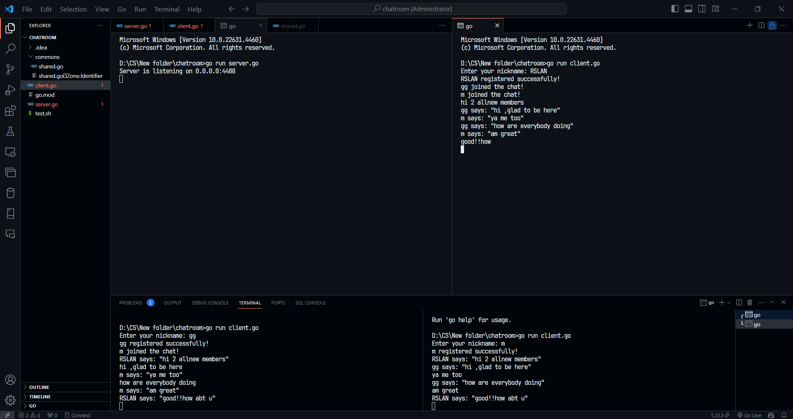
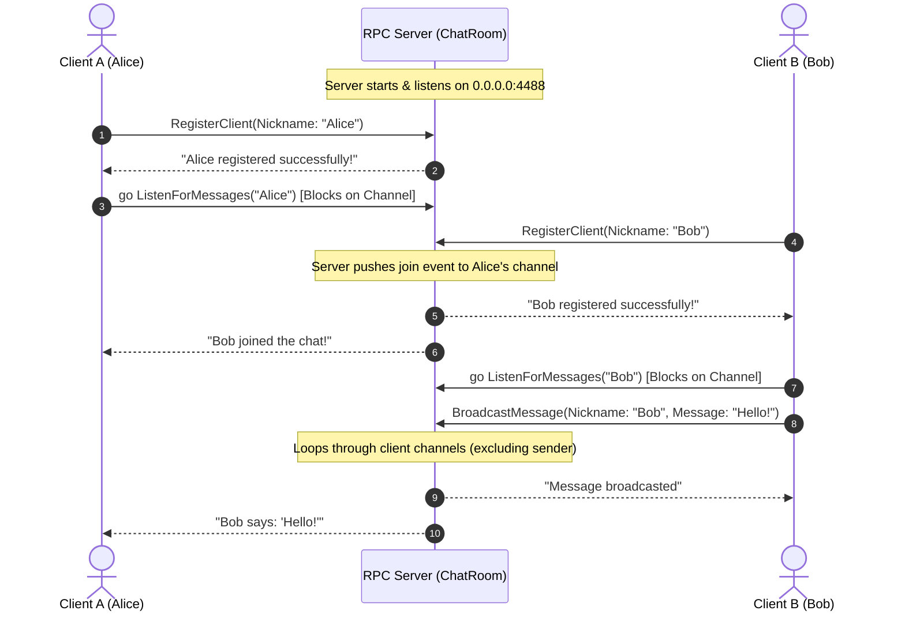

# 🚀 Event-Driven RPC Chat Room

[](https://golang.org/)
[](https://pkg.go.dev/net/rpc)
[]()
[]()

A distributed, event-driven terminal chatroom implemented in **Go** using the native `net/rpc` framework. The coordinating server orchestrates real-time event distribution and client synchronization using Go concurrency primitives (channels, mutexes, and goroutines).

---

## 📸 Demo Preview



*Simultaneous multi-client session showing user registration, arrival notifications, and live message broadcasting across terminals.*

---

## ✨ Features

- **Event-Driven Pub/Sub Model**: Instead of heavy polling, the coordinating server maintains active message channels for each registered client.
- **Go Standard RPC (`net/rpc`)**: Fast, lightweight communication over TCP (`0.0.0.0:4488`).
- **Real-Time Push Notifications**: When a new user registers or a message is sent, the server pushes events to all other connected client listeners.
- **Concurrency-Safe Synchronization**: State is protected with `sync.Mutex` to prevent race conditions during concurrent client registration and message delivery.
- **Dual-Threaded Client Architecture**:
  - Background goroutine actively awaits server-pushed RPC messages.
  - Main thread processes standard input (`os.Stdin`) to broadcast messages seamlessly.

---

## 🏛️ System Architecture

The following diagram illustrates how clients register, listen for events, and broadcast messages through the RPC Coordinator:



---

## 📁 Repository Structure

```text
EventDriven_RCPchatroom/
├── assets/
│   └── demo.png            # Multi-client execution screenshot
├── chatroom/
│   ├── commons/
│   │   └── shared.go       # Shared RPC structs (RegisterArgs, MessageArgs) & address config
│   ├── client.go           # CLI client: input scanner & message listener goroutine
│   ├── server.go           # Coordinating RPC server with channel dispatcher
│   ├── go.mod              # Go module definition
│   └── test.sh             # Linux/KDE automated multi-terminal launcher script
├── .gitignore              # Git ignore rules for Go binaries and OS/IDE files
└── README.md               # Project documentation
```

---

## 🔌 RPC Service Specification

The service registers under the namespace `ChatRoom`:

| Remote Procedure | Parameter Struct | Return Type | Description |
| :--- | :--- | :--- | :--- |
| `ChatRoom.RegisterClient` | `*commons.RegisterArgs` | `*string` | Registers a unique nickname, instantiates a message channel, and notifies all active participants. |
| `ChatRoom.ListenForMessages` | `string` (nickname) | `*string` | Awaiting event listener. Blocks on the client's internal channel until a message or notification is available. |
| `ChatRoom.BroadcastMessage` | `*commons.MessageArgs` | `*string` | Broadcasts an incoming message to all connected participants except the sender. |

### Shared Structures (`commons/shared.go`)

```go
type RegisterArgs struct {
    Nickname string
}

type MessageArgs struct {
    Nickname string
    Message  string
}
```

---

## 🚀 Getting Started

### Prerequisites

- [Go](https://go.dev/dl/) version **1.23** or higher installed.

Verify your Go installation:
```bash
go version
```

### Installation

1. Clone this repository:
   ```bash
   git clone https://github.com/Mohamed-Rslan/EventDriven_RCPchatroom.git
   cd EventDriven_RCPchatroom/chatroom
   ```

2. Download / verify module dependencies:
   ```bash
   go mod tidy
   ```

---

## 💻 Running the Application

### 1. Start the Server

Open a terminal and start the coordinating RPC server:

```bash
cd chatroom
go run server.go
```

Output:
```text
Server is listening on 0.0.0.0:4488
```

---

### 2. Connect Clients

Open one or more separate terminal windows for each user:

```bash
cd chatroom
go run client.go
```

1. Enter your chosen nickname when prompted:
   ```text
   Enter your nickname: Alice
   Alice registered successfully!
   ```
2. Type any message and press <kbd>Enter</kbd> to broadcast it to the room.
3. Observe live messages and join notifications pushed in real time.

---

### 3. Automated Multi-Client Test (Linux)

A test shell script `test.sh` is included to spawn the server and 4 client windows simultaneously using KDE `konsole`:

```bash
cd chatroom
chmod +x test.sh
./test.sh
```

---

## 🛠️ Technology Stack

- **Language**: [Go (Golang)](https://go.dev/)
- **IPC / Protocol**: Go standard library `net/rpc` over TCP
- **Concurrency**: Goroutines, Go Channels (`chan string`), `sync.Mutex`
- **I/O**: `bufio.Scanner` for terminal streaming

---

## 👤 Author

**Mohamed Rslan**
- GitHub: [@Mohamed-Rslan](https://github.com/Mohamed-Rslan)
- Email: [m.rslan4488@gmail.com](mailto:m.rslan4488@gmail.com)

---

## 📄 License

This project is licensed under the [MIT License](LICENSE) - open for educational and developmental purposes.
